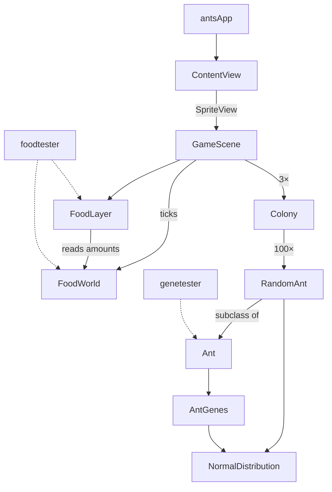

<!-- 🖊 TODO: Add a logo to docs/images/logo.png and uncomment:
<p align="center">
  
</p>
-->

# ants

> _Simulated ant colonies fight for space._
<!-- 🖊 TODO: Confirm the tagline. -->

`ants` is a simple MacOS SpriteKit simulation. Three colonies (red, black, and amber) each release 100 ants. The ants walk at random, and when ants of different colors touch, they fight until one dies. The project is a sandbox for experiments with ant behavior and with genetic inheritance. A gene model is in the code, but the simulation does not use it yet. The repo also has `genetester`, a command-line tool that shows how genes pass from parents to children across generations.

> **Status:** Experimental / proof-of-concept — use at your own risk.

---

## Table of Contents

- [Features](#features)
- [Prerequisites](#prerequisites)
- [Installation](#installation)
- [Quick Start](#quick-start)
- [Controls](#controls)
- [genetester](#genetester)
- [foodtester](#foodtester)
- [How It Works](#how-it-works)
- [Known Limitations](#known-limitations)
- [Contributing](#contributing)
- [License](#license)

---

## Features

- **Three competing colonies.** Red, black, and amber anthills each get a random position in a 1024 × 768 scene, at least two anthill-widths apart, and release 100 ants.
- **Random-walk movement.** Each frame, each ant turns by a small angle from a normal distribution (σ = 0.1 rad) and moves forward 2 points.
- **Size-based combat.** An ant's health and attack come from its size. When enemies touch, each one takes damage equal to the other's attack. An ant with health ≤ 0 is removed.
- **Visual health.** An ant fades (lower alpha) as it loses health.
- **Food on screen.** Twelve food locations seed at random at launch and draw as green
  spots. A full spot is large and clear; a shrinking spot fades, and an emptied spot
  disappears until the food grows back.
- **Fight log and sound.** Each fight plays `bite.m4a` and prints the result to the console, for example `R042[ 71] vs B017[ 88]`.
- **Gene model.** `AntGenes` has eight traits from 0.0 to 1.0: size, health, bite strength, armor, recovery, speed, vision, and carry capacity. A child gets each trait from one parent at random, plus a small normal-distribution change.

---

## Prerequisites

- **macOS** with **Xcode 27.1** or later (the project uses Xcode 27.1 recommended settings and the macOS 27 SDK)
- **Swift 5** language mode
- The app and `genetester` run on **macOS 14.0** or later

No package dependencies. The app uses only SwiftUI, SpriteKit, and GameplayKit.

---

## Installation

```sh
git clone https://github.com/PeteRichardson/ants.git
open ants/ants.xcodeproj
```

Select the `ants` scheme and **My Mac**, then press ⌘R.

Command line:

```sh
xcodebuild -project ants.xcodeproj -scheme ants -configuration Release build
```

The `ants` target uses automatic signing with a set development team, and the app is sandboxed (`ants/ants.entitlements`).
<!-- 🖊 TODO: Explain what a contributor must change to build with their own signing team. -->

---

## Quick Start

<!-- 🖊 TODO: Add a screenshot or GIF of the running simulation (required).
<p align="center">
  
</p>
-->

1. Run the `ants` scheme. A 1024 × 768 window opens with a sand background.
2. Three tinted anthills appear at random positions, and 300 ants start to walk out from them.
3. Watch the fights. Open the Xcode console (⇧⌘C) to see the fight log:

   ```
    R042[ 71] vs B017[ 88]:  R042 -36.0 | B017 -31.0
   	R042[-17] dies!  ants remaining = 287
   ```
   <!-- 🖊 TODO: Replace with real console output from a run. -->

The simulation has no end state. It continues until no more enemies meet.

---

## Controls

The app has no keyboard, mouse, or menu controls. The simulation starts on launch and runs without user input. To restart, quit and launch the app again.

---

## genetester

`genetester` is a command-line tool that tests the inheritance algorithm in `AntGene.swift`. It starts with two random ants. For 100 generations, it mates the last child with a new random ant and prints three gene lines: mother, father, and child.

### Build and run

```sh
xcodebuild -project ants.xcodeproj -scheme genetester -configuration Debug build
```

Or select the `genetester` scheme in Xcode and press ⌘R.

### Usage

```
genetester
```

The tool takes no arguments or options.

### Sample output

```
size: 0.66, health: 0.52, bite: 0.39, armor: 0.35, recovery: 0.44, speed: 0.35, vision: 0.56, capacity: 0.41
size: 0.54, health: 0.48, bite: 0.56, armor: 0.51, recovery: 0.50, speed: 0.40, vision: 0.59, capacity: 0.46
size: 0.70, health: 0.59, bite: 0.68, armor: 0.44, recovery: 0.47, speed: 0.46, vision: 0.43, capacity: 0.32
----------------------------------------------------------
size: 0.70, health: 0.59, bite: 0.68, armor: 0.44, recovery: 0.47, speed: 0.46, vision: 0.43, capacity: 0.32
size: 0.39, health: 0.60, bite: 0.41, armor: 0.36, recovery: 0.31, speed: 0.62, vision: 0.47, capacity: 0.55
size: 0.66, health: 0.68, bite: 0.44, armor: 0.41, recovery: 0.33, speed: 0.48, vision: 0.44, capacity: 0.43
----------------------------------------------------------
```

The third line of each block (the child) becomes the first line (the mother) of the next block.

---

## foodtester

`foodtester` is a command-line tool that tests the food rules in `FoodWorld.swift`: grid
geometry, seeding with keep-out areas, regrowth after a delay, the per-location cap, and
spillover to the eight adjacent locations. It also tests the drawing sync in
`FoodLayer.swift`: spots added, updated, removed, and re-added as cell amounts change. It
prints one `PASS` or `FAIL` line per rule and exits non-zero if any rule fails.

### Build and run

```sh
xcodebuild -project ants.xcodeproj -scheme foodtester -configuration Debug build
```

Or select the `foodtester` scheme in Xcode and press ⌘R. The tool takes no arguments or
options.

---

## How It Works



| File | Role |
|------|------|
| `ants/antsApp.swift` | `@main` SwiftUI app with one `WindowGroup` |
| `ants/ContentView.swift` | Hosts `GameScene` in a fixed 1024 × 768 `SpriteView` |
| `ants/GameScene.swift` | Zero-gravity physics world with edge walls; creates the colonies; sends contacts to ants |
| `ants/Colony.swift` | Anthill sprite; makes and updates its ants |
| `ants/Ant.swift` | Base ant: health, attack, combat, collision response |
| `ants/RandomAnt.swift` | Ant that turns at random and moves forward |
| `ants/AntGene.swift` | `AntGenes` traits and inheritance |
| `ants/FoodWorld.swift` | Food grid: seeding, regrowth after a delay, per-location cap, spillover |
| `ants/FoodLayer.swift` | Draws the food grid: one green spot per cell, sized and faded by its amount |
| `ants/NormalDistribution.swift` | Box–Muller normal random numbers from a `GKRandomSource` |
| `tools/genetester/main.swift` | Command-line inheritance test |
| `tools/foodtester/main.swift` | Command-line food rule tests |

---

## Known Limitations

- **Genes have no effect.** Ant size, health, and attack come from random ranges, not from `AntGenes`. Speed, vision, armor, recovery, and carry capacity are not used.
- **No reproduction.** Ants are only made when a colony starts. No ants are born during a run.
- **Ants do not eat yet.** `FoodWorld` models the food rules (seeding, regrowth, caps,
  spillover) and `FoodLayer` draws the spots, but ants do not take food from it, so spots
  only ever grow. Pheromones and foraging are not modelled.
- **Fixed scene size.** The scene is always 1024 × 768 points (`screenSize` in `ContentView.swift`).
- **All ants appear at once.** Each colony makes all 100 ants at start (`Colony.swift:25` has a TODO to spread this over time).
- **No tests.** The project has no unit or UI test targets.

<!-- 🖊 TODO: Review and expand — partially inferred from TODO comments and the current code. -->

---

## Contributing

```sh
git clone https://github.com/PeteRichardson/ants.git
cd ants
xcodebuild -project ants.xcodeproj -scheme ants build
xcodebuild -project ants.xcodeproj -scheme genetester build
```

Or build in Xcode with ⌘B. Commit messages use [Conventional Commits](https://www.conventionalcommits.org/).

<!-- 🖊 TODO: Say if you accept outside contributions, and how. -->

---

## License

Licensed under the **MIT License**. See [LICENSE](LICENSE) for details.
